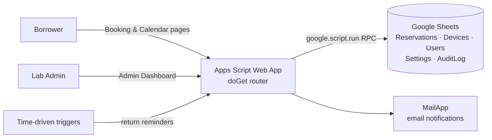

# Robotics Laboratory Reservation & Scheduling System

A web-based system for booking Robotics Laboratory equipment and schedules. Users check the calendar for free time slots and submit a reservation. Laboratory staff review, approve, and track every request from an admin dashboard.

Built on **Google Apps Script** and **Google Sheets**, with no external servers or paid services.

> **Live demo:** `[paste your demo web-app URL here]`
> **Demo admin login:** `demo` / `Demo1234!`
>
> The demo runs on a separate sandbox spreadsheet with sample data that **resets daily**. No real emails are sent: every notification the system would send appears on the public **Email Outbox** page.

---

## Screenshots

| Booking form | Calendar | Admin dashboard |
|---|---|---|
| `` | `` | `` |

| Bulk approve / decline | Device inventory | Email outbox (demo) |
|---|---|---|
| `` | `` | `` |

*(Replace the placeholders with screenshots taken from the demo.)*

---

## The problem

Laboratory equipment such as projectors, TVs, and robotics kits was booked informally, which led to double bookings, unreturned devices, and no record of who had what. The system replaces that with one shared schedule, enforced booking rules, and a full audit trail.

## Features

### For borrowers (public)
- **Interactive date picker** and two reservation types:
  - **Class**: predefined instructional time slots, capped at 2 consecutive hours per day
  - **Other purpose**: custom start/end time, capped at 3 hours
- **Live device availability**: shows remaining units for the selected slot as it is chosen
- **Location-aware filtering**: only devices allowed in the selected building/floor/room are shown. Room-fixed devices are auto-selected.
- **Accessory selection** per device (HDMI cable, remote, power cord, and so on)
- **Same-day return scheduling**, with return times generated after the reservation ends
- **"Also booked this slot"** panel that shows approved and pending bookings to reduce conflicts
- **Public calendar view**: class bookings appear in their fixed slots, and custom bookings show their actual start and end times

### For laboratory staff (admin)
- **Dashboard stats**: pending requests, approved today, overdue returns, total reservations
- **Pending approvals** with approve / edit / reject actions
- **Bulk actions**: select several (or all) requests and approve or decline them in one step, with one shared decline reason. Requests that fail stay selected so they can be retried.
- **Active & ongoing tracking** with overdue badges and "mark returned"
- **Reservation history** with filters (date, borrower, status) and **CSV export** by month range
- **Device inventory management**: quantity, building/room restrictions, accessories
- **Settings** and password management

### System
- **Email notifications**: confirmation, admin alert, approval/rejection, overdue return reminder
- **Automated return reminders** using time-driven triggers
- **Audit log** of every login, approval, rejection, and inventory change

---

## Tech stack

| Layer | Technology |
|---|---|
| Runtime / backend | Google Apps Script (V8) |
| Database | Google Sheets (one sheet per entity) |
| Frontend | HtmlService templates, vanilla JavaScript, CSS custom properties |
| Auth | Salted password hashing and server-side sessions in `CacheService` |
| Email | `MailApp` with HTML templates |
| Scheduling | Apps Script time-driven triggers |

## Architecture

### Project structure

| File | Responsibility |
|---|---|
| `Code.gs` | Web app router (`doGet`), page boot data, one-time setup |
| `Config.gs` | Constants: sheet names, time slots, subjects, defaults |
| `Reservation.gs` | Booking, availability and overlap checks, approve/reject logic |
| `Dashboard.gs` | Aggregated stats and the single-call admin snapshot |
| `BulkActions.gs` | Bulk approve / decline |
| `Inventory.gs` | Device and building management |
| `Authentication.gs` | Login, sessions, password and user management |
| `Email.gs` | HTML email templates and the mail gateway |
| `Audit.gs` | Write-once audit log |
| `Utils.gs` | Sheet access, IDs, password hashing, date formatting, cached settings |
| `Demo.gs` | Portfolio demo mode (demo deployment only) |
| `Booking.html` / `Calendar.html` / `DashboardPage.html` / `Login.html` / `Styles.html` | UI pages and shared styles |

---

## Engineering highlights

### Performance
Apps Script server calls take around 0.5–1.5 s each, so the main optimization was cutting the number of calls:

- **Admin dashboard load: 5 calls → 1.** One `getAdminSnapshot()` returns stats, pending, and approved reservations together. Before, the page made 5 calls, and one had to finish before the others started.
- **After approve/reject: 3 calls → 1**, plus an **optimistic UI**: the card disappears right away and the data syncs in the background.
- **Config is embedded into the page at render time**, which removes a full round trip on every page load. The calendar's reservations are embedded the same way.
- **Debounced, stale-safe availability checks**: quick dropdown changes are combined into one request, and out-of-date responses are discarded.
- **Smaller rendering costs**: reservations are grouped by date once instead of filtered for each of the 42 calendar cells; DOM fragments and event delegation replace repeated `innerHTML +=` and per-element listeners; device rules are looked up by name.
- **Audit log reads only the last N rows** instead of the whole, ever-growing sheet.

### Security
- Passwords are stored as **salted hashes**, never in plain text.
- **Server-side sessions** with expiry. Admin endpoints check the session token.
- **HTML escaping** of all user-supplied text before rendering.
- **Bulk operations run sequentially** on the server, so device-capacity checks still apply to each approval.

---

## Demo mode

The public demo is a **separate copy** of the project bound to its own spreadsheet, so the real system, its data, and its users are never touched.

Adding one file (`Demo.gs`) to the copy turns demo mode on. Without that file, the shared code behaves exactly like production.

| Concern | How demo mode handles it |
|---|---|
| Visitors typing real email addresses | **No email is ever sent.** All mail goes through `sendMail_()`, which captures it in a `DemoOutbox` sheet with addresses masked, viewable at `?page=outbox`. |
| Visitors locking others out | Password change and user management are disabled for the shared demo account. |
| Messy data after many visitors | `resetDemo()` re-seeds realistic sample data (dates relative to today) **every day**. |
| Accidentally wiping real data | `resetDemo()` refuses to run unless the spreadsheet's name contains **"DEMO"**. |
| Unsafe HTML in captured emails | Each email preview renders in a **sandboxed iframe** with scripts disabled. |
| Making the demo obvious | A dismissible **DEMO MODE** banner appears on every page and shows the demo login on the admin pages. |

### Run your own demo copy
1. Create a new Google Sheet with **DEMO** in its name (for example, `Robotics Lab Reservation — DEMO`).
2. Open **Extensions → Apps Script**, then add all project files plus `Demo.gs`.
3. In **Project Settings**, set the time zone to `Asia/Manila`.
4. Run **`setupDemo()`** once and authorize. This creates the sheets, seeds the sample data, and installs the daily reset.
5. Go to **Deploy → New deployment → Web app**, with *Execute as: Me* and *Who has access: Anyone*.
6. Put the web-app URL in the "Live demo" link above.

---

## Future improvements
- Require an admin token check on every admin-only endpoint, including single approve/reject
- Let borrowers edit or cancel their own reservation using their reservation code
- Usage analytics: device usage rates and peak hours
- Optional Google Calendar sync for approved reservations

## Author
**[Your Name]** — [Your role]
[Portfolio / LinkedIn / GitHub links]

*Developed for the Robotics Laboratory, [University / Department].*
